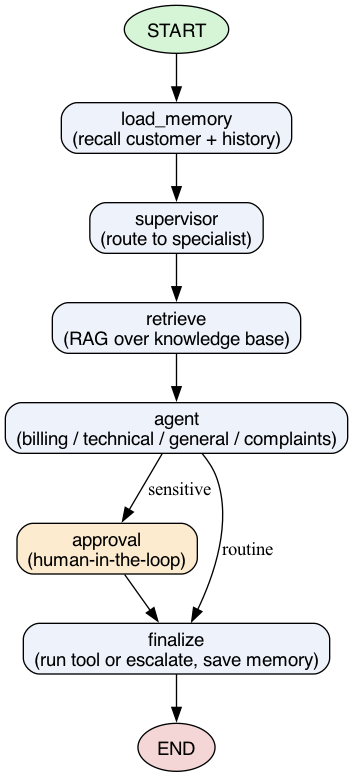

# CustomerSupportAI

An agentic customer-support assistant for a fictional software company
(**CloudNest**), built with **LangGraph** and a **local Llama 3.1 model via
Ollama**. It routes each customer message to a specialist agent, answers from
company documents using RAG, remembers past conversations, performs real actions
on sample data, and pauses for human approval before anything sensitive.

Everything runs locally — no API keys, no cloud costs.

See [`PROJECT_SPEC.md`](PROJECT_SPEC.md) for the full design and all the
decisions behind it.

---

## What it does

- **Multi-agent routing** — a supervisor sends each message to one of four
  specialist agents: **Billing**, **Technical**, **General/FAQ**, or
  **Complaints/Escalation**.
- **RAG** — answers are grounded in four knowledge-base documents
  (`knowledge_base/`), embedded into a ChromaDB vector store.
- **Persistent memory** — customers, conversations, summaries, and tickets are
  stored in SQLite (`memory.db`) and recalled across sessions.
- **Tools on sample data** — the agents can look up customers, issue refunds,
  cancel accounts, and open tickets against ~15 seeded sample customers.
- **Human-in-the-loop** — the workflow genuinely pauses (LangGraph `interrupt`)
  for a human to **approve / reject / edit** before:
  - a refund **over $100**,
  - **any** account cancellation,
  - an **angry complaint**,
  - a **low-confidence** answer (the knowledge base doesn't cover the question).
  On **reject**, the sensitive action is *not* performed, an escalation ticket is
  created, and the customer is told a human will follow up.



---

## Requirements

- **Python 3.12**
- **[Ollama](https://ollama.com)** installed and running
- Two Ollama models:
  - `llama3.1:8b` (chat)
  - `nomic-embed-text` (embeddings)
- About 6 GB of disk for the models, and ~8 GB RAM free to run the 8B model.

---

## Setup

### 1. Install Ollama and pull the models

Download Ollama from https://ollama.com (on Linux: `curl -fsSL
https://ollama.com/install.sh | sh`), then in a terminal:

```bash
ollama pull llama3.1:8b
ollama pull nomic-embed-text
```

Ollama runs a local server at `http://localhost:11434` automatically. Leave it
running while you use the app. (On Linux the installer registers a background
service; if the server isn't running, start it with `ollama serve`.)

### 2. Create a virtual environment and install dependencies

**macOS:**

```bash
python3.12 -m venv venv
source venv/bin/activate
pip install --upgrade pip
pip install -r requirements.txt
```

**Linux (Debian/Ubuntu):**

```bash
# install Python 3.12 if it isn't already present
sudo apt install python3.12 python3.12-venv

python3.12 -m venv venv
source venv/bin/activate
pip install --upgrade pip
pip install -r requirements.txt
```

**Windows (PowerShell):**

```powershell
py -3.12 -m venv venv
venv\Scripts\Activate.ps1
pip install --upgrade pip
pip install -r requirements.txt
```

**Windows (Git Bash):**

```bash
py -3.12 -m venv venv
source venv/Scripts/activate
pip install --upgrade pip
pip install -r requirements.txt
```

> The workflow diagram (`workflow.png`) is regenerated with the `graphviz`
> Python package, which needs the Graphviz program installed (`brew install
> graphviz` on macOS, `sudo apt install graphviz` on Linux, or download it on
> Windows). This is only needed if you want to regenerate the diagram — a
> prebuilt `workflow.png` is already included.

### 3. Moving the project between machines

The code is cross-platform and runs identically on macOS, Linux, and Windows.
Two folders do **not** transfer between machines and should be left behind (both
are git-ignored and rebuilt automatically):

- `venv/` — recreate it with the steps above on the new machine.
- `vectorstore/` — ChromaDB files are not portable across machines or
  architectures. Delete it if present; the app re-embeds the knowledge base on
  the next run (~10 seconds).

---

## Running

```bash
python main.py
```

You'll be asked for a customer ID or email (optional — press Enter to continue
as a guest). Then chat with the assistant. Use one of the seeded customers for
account actions, for example:

- `CUST001` / `alice@example.com` — Pro plan
- `CUST004` / `david@example.com` — has a $290 order (refund needs approval)
- `CUST002` / `bob@example.com` — Basic plan ($9 order, refund needs no approval)

Type `quit` or `exit` to leave.

### Example things to try

| Try typing | What happens |
|---|---|
| `How much is the Pro plan?` | General agent answers from the pricing guide (RAG) |
| `I get error ERR_SYNC_409` | Technical agent explains the file-conflict fix |
| `Please refund my last payment` (as `CUST004`) | Billing agent → **approval prompt** (refund > $100) |
| `Can I get a refund on my $9 charge?` (as `CUST002`) | Refund runs immediately (≤ $100, no approval) |
| `Cancel my subscription` (as `CUST001`) | **Approval prompt**; reject → escalation ticket |
| `Does CloudNest integrate with Salesforce?` | Not in the knowledge base → low-confidence → escalate |

---

## Evaluation

A behaviour-based test suite runs 21 checks across routing, RAG grounding,
missing-information handling, memory recall, approval triggering, rejection, and
action execution. It uses its own throwaway database and never touches your real
`memory.db`.

```bash
python evaluate.py
```

Expected output ends with `RESULT: 21/21 checks passed, 0 failed.`

---

## Project structure

```
CustomerSupportAI/
├── main.py            # CLI chat loop (handles the approval pause)
├── graph.py           # LangGraph workflow + workflow.png generator
├── state.py           # the shared workflow state (TypedDict)
├── supervisor.py      # routes a message to one of the four agents
├── agents.py          # the four specialist agents + billing-intent extractor
├── human_loop.py      # human approval node + CLI approve/reject/edit prompt
├── rag.py             # knowledge-base ingestion + retrieval (ChromaDB)
├── memory.py          # SQLite: customers, orders, memory, tickets, and tools
├── config.py          # all paths, model names, and business rules
├── schema.sql         # the database schema (documentation)
├── evaluate.py        # 21-check behaviour evaluation
├── knowledge_base/    # company_policy, pricing_guide, technical_manual, faq
├── PROJECT_SPEC.md    # full design and decisions
├── requirements.txt
└── workflow.png
```

Generated at runtime (ignored by git): `venv/`, `vectorstore/`, `memory.db`.

---

## How a message flows through the system

1. **load_memory** — identify the customer, recall recent history.
2. **supervisor** — classify the message into one of the four categories.
3. **retrieve** — fetch the most relevant knowledge-base chunks (RAG).
4. **agent** — the specialist drafts a reply and decides on an action; code then
   decides whether human approval is required.
5. **approval** *(only if needed)* — the workflow pauses for a human decision.
6. **finalize** — run the tool (or escalate on rejection), then save the
   conversation to memory.
